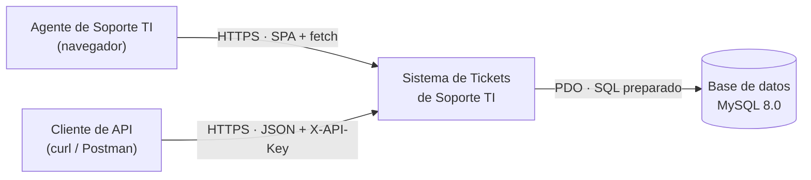
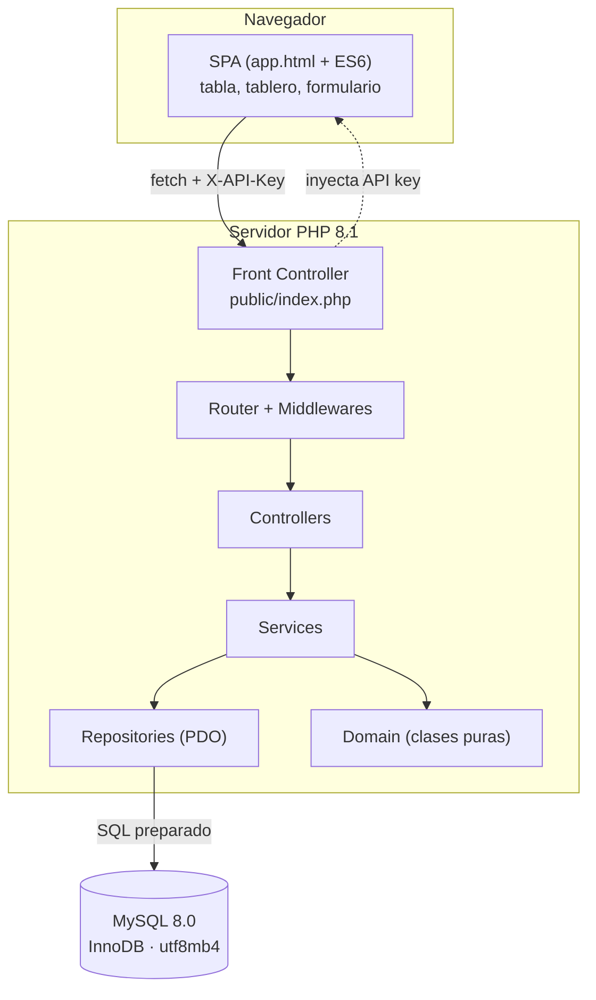
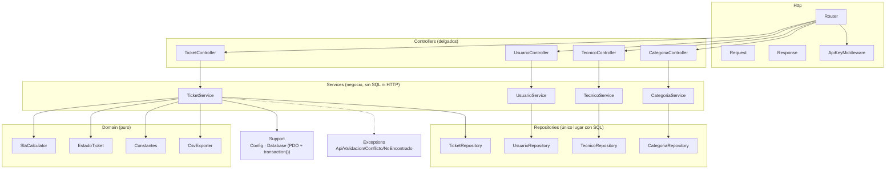
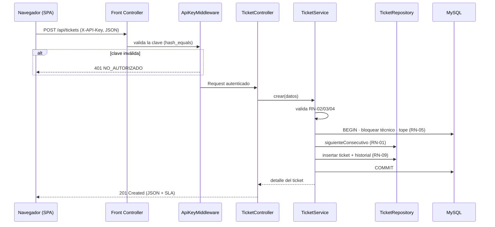

# 02 — Arquitectura

> **Metodología:** modelo C4 (contexto → contenedores → componentes). Diagramas en Mermaid
> (texto versionable). Fuente en [`diagrams/`](diagrams/).

## 1. Nivel 1 — Contexto

El sistema es autónomo: no depende de servicios externos. Los usuarios interactúan por la SPA;
otros consumidores usan la API directamente.

## 2. Nivel 2 — Contenedores

| Contenedor | Responsabilidad | Tecnología |
| --- | --- | --- |
| **SPA** | Interfaz de una página; consume la API por `fetch` | HTML5 + JS ES6 vanilla + CSS propio |
| **Front Controller** | Único punto de entrada; sirve la SPA e inyecta la API key; ruta `/api/*` | `public/index.php` |
| **Router + Middlewares** | Resuelve rutas, aplica la API key, responde 404/405 | PHP |
| **Controllers / Services / Repositories / Domain** | Capas de la aplicación | PHP 8.1 |
| **Base de datos** | Persistencia relacional | MySQL 8.0 (InnoDB, utf8mb4) |

## 3. Nivel 3 — Componentes (lado servidor)

### Reglas de dependencia (AGENTS.md §3)

- **Controller:** delgado. Cero SQL, cero lógica de negocio; traduce Request → Service → Response.
- **Service:** no conoce HTTP (`$_GET`, `$_POST`) ni ejecuta SQL; **orquesta transacciones** y reglas.
- **Repository:** el **único** lugar con SQL y PDO (verificado por `guards.sh`).
- **Domain:** sin dependencias externas; lógica pura (transiciones, SLA, CSV).

## 4. Flujo de una petición

## 5. Decisiones de arquitectura

Ver los registros completos en [`06-decisiones/`](06-decisiones/):

| ADR | Decisión |
| --- | --- |
| [ADR-001](06-decisiones/ADR-001-php-nativo-sin-framework.md) | PHP nativo en capas, sin framework |
| [ADR-002](06-decisiones/ADR-002-consecutivo-seguro.md) | Consecutivo anual con transacción y `FOR UPDATE` |
| [ADR-003](06-decisiones/ADR-003-api-key-middleware.md) | API key por middleware (`hash_equals`, fail-closed) |
| [ADR-004](06-decisiones/ADR-004-spa-vanilla-sin-cdn.md) | SPA vanilla sin framework ni CDN |
| [ADR-005](06-decisiones/ADR-005-reglas-como-datos.md) | Transiciones y SLA como datos del dominio |

## 6. Despliegue

- **Desarrollo:** servidor embebido `php -S localhost:8080 -t public public/index.php`.
- **Contenedores:** `docker compose up` (Apache + PHP 8.1 y MySQL 8.0); ver [`README.md`](../README.md).
- **Producción:** cualquier servidor con PHP 8.1+ y MySQL 8.0+; la **única** carpeta expuesta es `public/`
  (con `public/.htaccess` reescribiendo al Front Controller).
