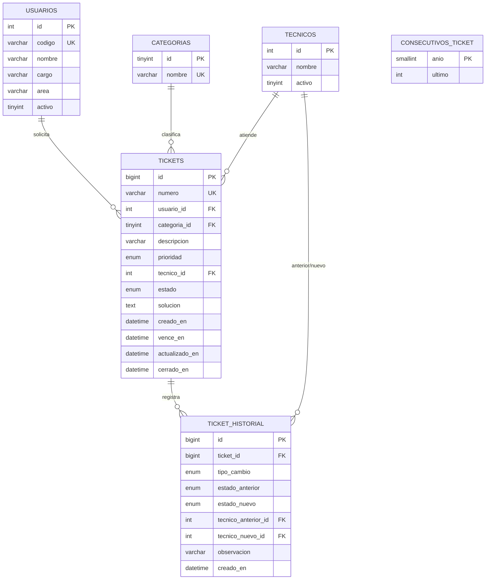
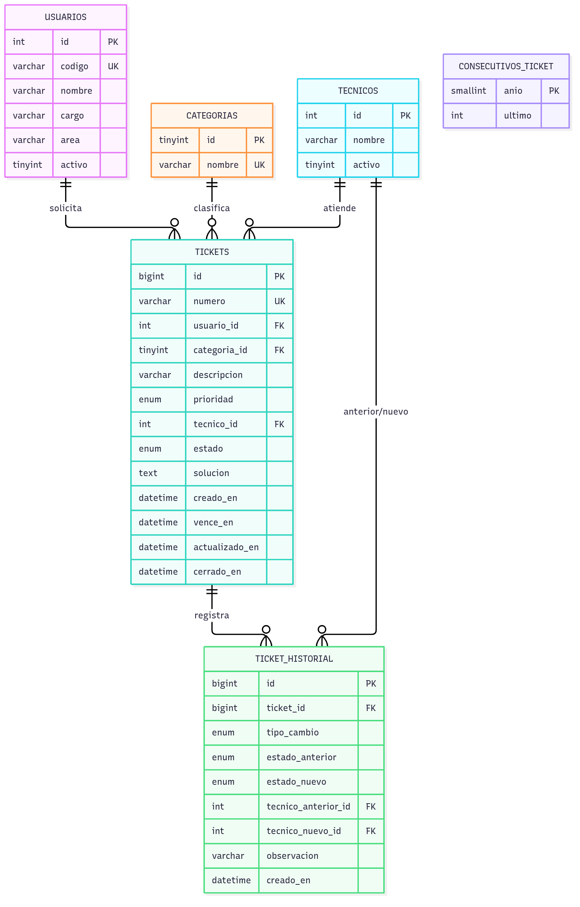

# 03 — Modelo de Datos

> **Fuente:** [`database/schema.sql`](../database/schema.sql) (esquema) y [`database/seed.sql`](../database/seed.sql) (datos).
> **Motor:** MySQL 8.0+ · **Almacenamiento:** InnoDB · **Charset:** `utf8mb4` / `utf8mb4_unicode_ci`.

## 1. Diagrama entidad-relación

## 2. Diccionario de datos

### 2.1 `categorias` — catálogo de clasificación

| Campo | Tipo | Nulo | Clave | Descripción |
| --- | --- | --- | --- | --- |
| `id` | `TINYINT UNSIGNED` | No | PK, AI | Identificador. |
| `nombre` | `VARCHAR(50)` | No | UNIQUE | Nombre visible (Hardware, Software, Red, Otro). |

### 2.2 `usuarios` — solicitantes internos

| Campo | Tipo | Nulo | Clave | Descripción |
| --- | --- | --- | --- | --- |
| `id` | `INT UNSIGNED` | No | PK, AI | Identificador interno. |
| `codigo` | `VARCHAR(20)` | No | UNIQUE | Código de empleado (`U001`…), usado por `GET /api/usuarios/{codigo}`. |
| `nombre` | `VARCHAR(120)` | No | idx | Nombre completo. |
| `cargo` | `VARCHAR(100)` | No | | Cargo del colaborador. |
| `area` | `VARCHAR(100)` | No | | Área o departamento. |
| `activo` | `TINYINT(1)` | No | CHECK | `1` puede crear tickets; `0` es rechazado (RN-02). |

### 2.3 `tecnicos` — personal de soporte

| Campo | Tipo | Nulo | Clave | Descripción |
| --- | --- | --- | --- | --- |
| `id` | `INT UNSIGNED` | No | PK, AI | Identificador. |
| `nombre` | `VARCHAR(120)` | No | | Nombre del técnico. |
| `activo` | `TINYINT(1)` | No | CHECK, idx | `1` recibe asignaciones; `0` no se ofrece. |

### 2.4 `consecutivos_ticket` — contador anual (RN-01)

| Campo | Tipo | Nulo | Clave | Descripción |
| --- | --- | --- | --- | --- |
| `anio` | `SMALLINT UNSIGNED` | No | PK | Año del consecutivo (`2026`). |
| `ultimo` | `INT UNSIGNED` | No | | Último número entregado. Se lee con `FOR UPDATE` dentro de la transacción. |

> Se inicializa con `INSERT IGNORE` y se incrementa con `UPDATE ... +1` **dentro** de la transacción de creación.
> Si la operación falla (p. ej. tope del técnico), el `ROLLBACK` **no quema** el consecutivo.

### 2.5 `tickets` — entidad principal

| Campo | Tipo | Nulo | Clave | Descripción |
| --- | --- | --- | --- | --- |
| `id` | `BIGINT UNSIGNED` | No | PK, AI | Identificador interno. |
| `numero` | `VARCHAR(14)` | No | UNIQUE | `TK-AAAA-NNNNNN`; segunda barrera contra duplicados (RN-01). |
| `usuario_id` | `INT UNSIGNED` | No | FK → `usuarios` | Solicitante. |
| `categoria_id` | `TINYINT UNSIGNED` | No | FK → `categorias` | Clasificación. |
| `descripcion` | `VARCHAR(1000)` | No | CHECK 20–1000 | Detalle del problema (RN-03). |
| `prioridad` | `ENUM('Alta','Media','Baja')` | No | idx | Define las horas de SLA (RN-08). |
| `tecnico_id` | `INT UNSIGNED` | No | FK → `tecnicos` | Responsable actual. |
| `estado` | `ENUM('ABIERTO','EN CURSO','CERRADO')` | No | idx | Estado en la máquina de estados (RN-06). Por defecto `ABIERTO`. |
| `solucion` | `TEXT` | Sí | CHECK | Obligatoria al cerrar (RN-06). |
| `creado_en` | `DATETIME` | No | idx | Fecha de creación (hora de Colombia). |
| `vence_en` | `DATETIME` | No | CHECK | `creado_en` + horas de la prioridad; se calcula al crear. |
| `actualizado_en` | `DATETIME` | No | | `CURRENT_TIMESTAMP ON UPDATE CURRENT_TIMESTAMP`. |
| `cerrado_en` | `DATETIME` | Sí | | Fecha de cierre; obligatoria si el estado es `CERRADO`. |

**Restricciones (`CHECK`) que reforzcan las reglas en la propia BD:**

| Constraint | Regla que respalda |
| --- | --- |
| `chk_tickets_descripcion` (`CHAR_LENGTH` entre 20 y 1000) | RN-03 |
| `chk_tickets_vence` (`vence_en > creado_en`) | RN-08 |
| `chk_tickets_cierre` (`CERRADO` ⇒ `solucion` y `cerrado_en` no nulos) | RN-06 |

### 2.6 `ticket_historial` — auditoría (RN-09)

| Campo | Tipo | Nulo | Descripción |
| --- | --- | --- | --- |
| `id` | `BIGINT UNSIGNED` | No | PK, AI. |
| `ticket_id` | `BIGINT UNSIGNED` | No | FK → `tickets` (`ON DELETE CASCADE`). |
| `tipo_cambio` | `ENUM('CREACION','ESTADO','REASIGNACION')` | No | Naturaleza del evento. |
| `estado_anterior` | `ENUM(...)` | Sí | `NULL` en la creación. |
| `estado_nuevo` | `ENUM(...)` | No | Estado resultante. |
| `tecnico_anterior_id` | `INT UNSIGNED` | Sí | `NULL` salvo en reasignación. |
| `tecnico_nuevo_id` | `INT UNSIGNED` | Sí | Técnico asignado. |
| `observacion` | `VARCHAR(1000)` | Sí | Nota del cambio o solución aplicada. |
| `creado_en` | `DATETIME` | No | Momento del evento. |

> Toda creación, cambio de estado o reasignación inserta una fila aquí **en la misma transacción** (RN-09).

## 3. Índices y justificación

| Índice | Tabla | Para qué |
| --- | --- | --- |
| `uq_tickets_numero` | `tickets` | Unicidad del consecutivo y búsqueda por número (detalle). |
| `idx_tickets_estado` | `tickets` | Filtro por estado y conteos del tablero. |
| `idx_tickets_prioridad` | `tickets` | Filtro por prioridad. |
| `idx_tickets_tecnico_est` | `tickets` | Carga activa por técnico (RN-05) y filtro por técnico. |
| `idx_tickets_usuario` | `tickets` | Filtro/búsqueda por usuario. |
| `idx_tickets_categoria` | `tickets` | Filtro por categoría. |
| `idx_tickets_creado` | `tickets` | Orden por fecha de creación (tabla y export). |
| `idx_tickets_estado_vence` | `tickets` | Cálculo rápido de vencidos activos (tablero). |
| `idx_historial_ticket` | `ticket_historial` | Carga del historial en orden cronológico. |

## 4. Datos de prueba (`seed.sql`)

El `seed.sql` es **re-ejecutable** (limpia y vuelve a insertar) y deja:

- **4 categorías** fijas: Hardware, Software, Red, Otro (van en el esquema).
- **10 usuarios** `U001`…`U010`, con **`U010` inactivo** para probar el rechazo de RN-02.
- **4 técnicos** activos `1`–`3` y **el 4 inactivo**, con cargas pensadas para probar el tope (RN-05).
- **25 tickets** repartidos entre estados, prioridades, **vencidos** y **por vencer** para ejercitar el SLA.
- El **consecutivo del año** en `25`, coherente con los 25 tickets sembrados.
