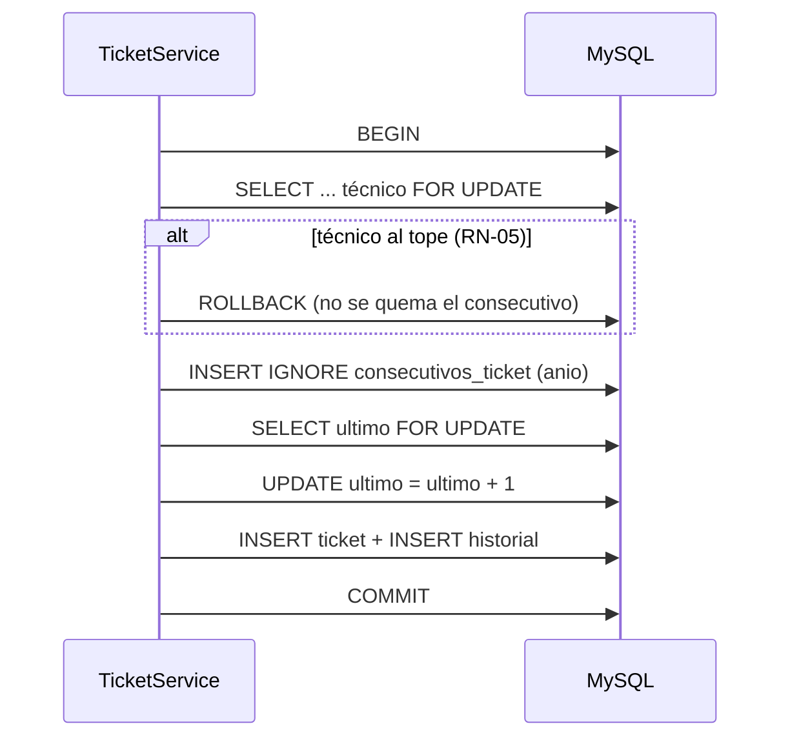
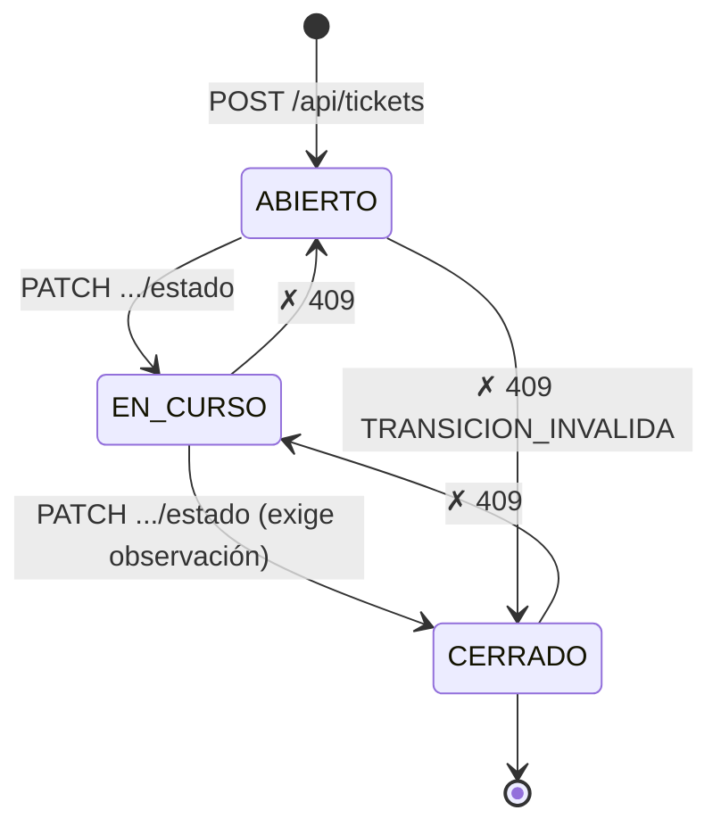
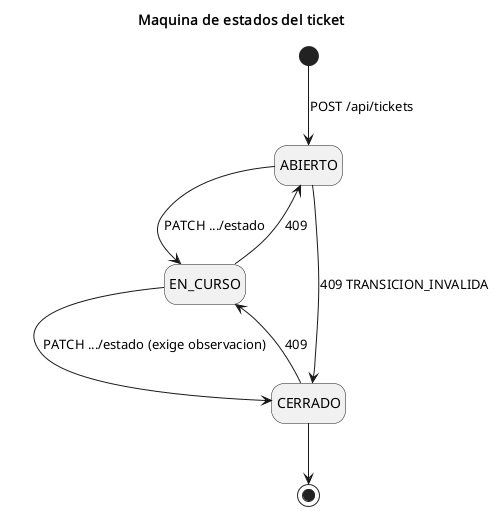

# 05 — Reglas de Negocio (RN)

> **Fuente de la verdad:** AGENTS.md §6. Cada regla tiene un ID y el código que la implementa
> la referencia con un comentario (`// RN-xx`) para poder rastrearla.

## RN-01 — Consecutivo seguro `TK-AAAA-NNNNNN`

El número del ticket se genera de forma **atómica y concurrente** en una transacción, con un
orden de bloqueos fijo que evita deadlocks: **ticket → técnico → consecutivo**.

- `tickets.numero` es `UNIQUE`: **segunda barrera** si algo fallara en el contador.
- Si la creación falla (p. ej. `TECNICO_AL_TOPE`), el `ROLLBACK` **no** consume el consecutivo.

**Implementación:** `src/Services/TicketService.php` (`crearEnTransaccion`), `src/Repositories/TicketRepository.php` (`siguienteConsecutivo`).

---

## RN-02 — Validación del solicitante

El `usuario_codigo` debe existir en `usuarios` y tener `activo = 1`. Si no → **422** con
`fields: { "usuario_codigo": "…" }`.

**Implementación:** `UsuarioRepository::buscarActivoPorCodigo`, `TicketService`.

---

## RN-03 — Descripción

Obligatoria, entre **20 y 1000 caracteres** (`trim` previo, `mb_strlen`). Fuera de rango → **422**
en `descripcion`. La BD lo respalda con `chk_tickets_descripcion`.

**Implementación:** `TicketService`.

---

## RN-04 — Categoría y prioridad

- La categoría debe existir en `categorias` → si no, **422** en `categoria_id`.
- `prioridad ∈ { Alta, Media, Baja }` → si no, **422** en `prioridad`.

**Implementación:** `CategoriaRepository`, `src/Domain/Constantes.php` (`PRIORIDADES`).

---

## RN-05 — Control de carga máxima del técnico

- Solo se asignan **técnicos activos**.
- **Carga** = tickets en estado `ABIERTO` o `EN CURSO`.
- Máximo **5 tickets activos** (`Constantes::MAX_TICKETS_TECNICO = 5`).
- En asignación/reasignación se bloquea la fila del técnico con `FOR UPDATE`; superar la cuota → **409 `TECNICO_AL_TOPE`**.
- En reasignación al **mismo** técnico, el ticket no cuenta dos veces.

**Implementación:** `src/Domain/Constantes.php`, `TecnicoRepository` (carga), `TicketService` (decisión).

---

## RN-06 — Máquina de estados inflexible

Flujo **exclusivo**: `ABIERTO ➔ EN CURSO ➔ CERRADO`. Prohibido saltar, retroceder o reabrir.

- Transición inválida → **409 `TRANSICION_INVALIDA`**.
- Estado desconocido → **422 `VALIDACION`**.
- Cerrar exige `observacion` (solución aplicada); se guarda en `tickets.solucion`. Sin ella → **422**.
- El ticket se lee con `FOR UPDATE` **antes** de validar la transición.

**Implementación:** `src/Domain/EstadoTicket.php` (transiciones como datos), `TicketService::cambiarEstado`.

---

## RN-07 — Reasignación de tickets cerrados

No se puede reasignar un ticket en estado `CERRADO` → **409**.

**Implementación:** `TicketService::reasignarTecnico`.

---

## RN-08 — SLA e indicadores

| Prioridad | Vencimiento |
| --- | --- |
| **Alta** | `creado_en` **+ 4 h** |
| **Media** | `creado_en` **+ 24 h** |
| **Baja** | `creado_en` **+ 72 h** |

`vence_en` se calcula al crear y se guarda. El indicador se deriva en cada lectura:

| Indicador | Condición |
| --- | --- |
| `CERRADO` | — (`sla = null`) |
| `VENCIDO` | `now > vence_en` y no está cerrado |
| `POR_VENCER` | tiempo restante `< 25 %` del total (`vence_en - now < 0.25 * (vence_en - creado_en)`) |
| `EN_TIEMPO` | cualquier otro caso activo |

- La clase es **pura**: recibe `now` por parámetro (fácil de testear, sin depender del reloj).

**Implementación:** `src/Domain/SlaCalculator.php` (`HORAS_POR_PRIORIDAD`, `UMBRAL_POR_VENCER = 0.25`).

---

## RN-09 — Auditoría e historial

Toda **creación**, **cambio de estado** o **reasignación** inserta una fila en `ticket_historial`
**en la misma transacción** que la operación. El detalle (`GET /api/tickets/{numero}`) devuelve el
historial en orden cronológico.

**Implementación:** `TicketRepository::insertarHistorial`, llamada desde cada mutación del `TicketService`.

---

## Resumen de códigos HTTP por regla

| Regla | Resultado exitoso | Error asociado |
| --- | --- | --- |
| RN-01 | `201` con número único | `500` si falla la BD (genérico) |
| RN-02 | `201` | `422` `validacion` (`usuario_codigo`) |
| RN-03 | `201` | `422` `validacion` (`descripcion`) |
| RN-04 | `201` | `422` `validacion` |
| RN-05 | `201` / `200` | `409` `TECNICO_AL_TOPE` |
| RN-06 | `200` | `409` `TRANSICION_INVALIDA` / `422` |
| RN-07 | `200` | `409` |
| RN-08 | — (cálculo) | — |
| RN-09 | — (efecto) | — |
